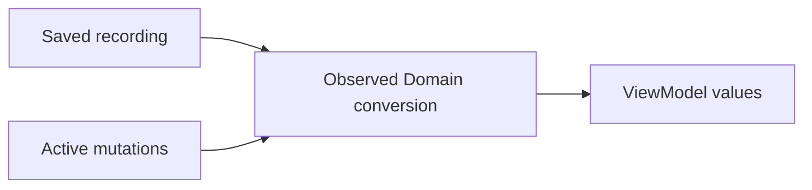
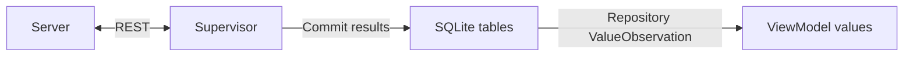
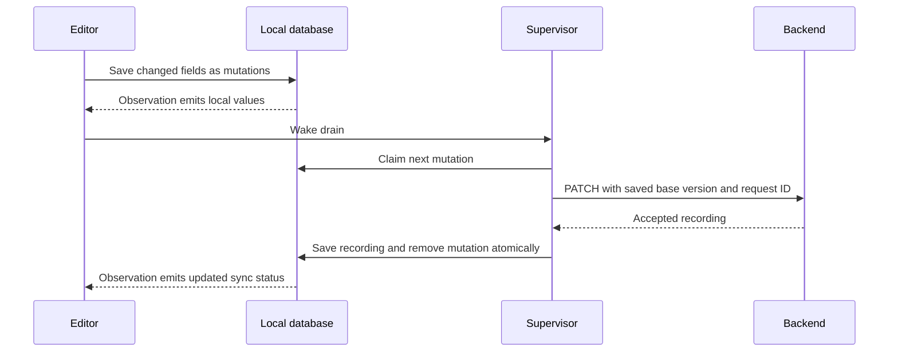

# PocketDemo: design

TypeScript on Bun (`Bun.serve`, `bun:sqlite`), one process, one SQLite file. The backend contract is implemented. The iOS implementation and its data flows are documented below.

## Problem

Two or more simulators edit the same recordings, sometimes offline, against one local server. The server must:

- detect conflicting edits without silently dropping either side;
- apply a retried edit exactly once, even when the first attempt committed but the client never heard back;
- let a device catch up on everything that changed without re-downloading transcripts.

The app is local-first. ViewModel ↔ Repository ↔ LocalDB, and a Supervisor actor syncs LocalDB ↔ NetworkManager. The app keeps a mutations table (id, record_id, action, old/new values, timestamp) that it drains to the server after reconnecting. The server contract has to fit that drain loop.

Constraints carried in:

- REST.
- Recording = id, title, summary, transcript. The transcript is immutable.
- Edit by id with optional title and summary.
- A cursor-paginated list with a limit, loaded 30 at a time as the user scrolls.
- 6–8 hour timebox: small and reliable over elaborate.

## Usage (caller's view)

```bash
# Every request carries a stable per-install id
H='X-Device-Id: sim-a'

# The list the user scrolls: newest first, 30 at a time. Every page also returns the change-feed cursor.
curl -H "$H" 'localhost:8787/recordings/browse?limit=30'
# -> { "items": [ {id,title,summary,version,createdAt,updatedAt,updatedBy,segmentCount,deleted:false}... ],
#      "nextCursor": "e1f3…:c1760000000000:rec_071", "hasMore": true, "syncCursor": "e1f3…:v100" }
curl -H "$H" 'localhost:8787/recordings/browse?limit=30&after=e1f3…:c1760000000000:rec_071'

# Every later refresh: changes after the saved cursor, edits and tombstones; keep passing back nextCursor
curl -H "$H" 'localhost:8787/recordings?cursor=e1f3…:v100&limit=30'
# -> { "items": [...], "nextCursor": "e1f3…:v104", "hasMore": false }

# Detail with transcript. Fetched once, cached forever: the transcript never changes.
curl -H "$H" localhost:8787/recordings/rec_042

# Edit. Send only the changed fields, the version you edited, and the mutation id as the key.
curl -X PATCH -H "$H" -H 'Idempotency-Key: 6c1e…' -H 'Content-Type: application/json' \
  -d '{"baseVersion": 42, "title": "Standup notes"}' localhost:8787/recordings/rec_042
# 200 { recording }                        applied (or replayed: header Idempotent-Replayed: true)
# 409 { error, conflicts:[{field,yours,theirs,changedBy,changedAt}], current }
# 410 { error: { code: "recording_deleted" } }   another device deleted it; no restore

# Delete (tombstone). Same conflict and retry rules as edit.
curl -X DELETE -H "$H" -H 'Idempotency-Key: 9a0b…' 'localhost:8787/recordings/rec_042?baseVersion=42'

# Lost-ack fault, per simulator (control routes are never faulted). `latest` is the device that sent the last request.
curl -X PUT -d '{"dropResponses":1}' localhost:8787/_sim/devices/latest  # next write commits, then the socket is cut
```

Swift side, inside the Supervisor drain loop:

```swift
for m in try localDB.pendingMutations() {            // FIFO, status = pending or inflight
    try localDB.markInflight(m.id)
    switch try await api.send(m) {                   // PATCH or DELETE, Idempotency-Key = m.id
    case .applied(let rec):    try localDB.ack(m.id, server: rec)
    case .conflict(let c):     try localDB.markConflicted(m.id, c)   // resolve UI reads it from LocalDB
    case .deleted:             try localDB.dropDeleted(m.recordingId) // tell user it no longer exists; remove locally
    case .transportError:      return                                // keep inflight; resend same id later
    }
}
let page = try await api.list(cursor: localDB.cursor, limit: 30)     // repeat while hasMore
try localDB.mergeServerPage(page)                    // 3-way merge where pending mutations exist
```

### Client mutations table (app LocalDB, shown for the contract)

```
mutations
  id            TEXT PK          -- UUID, sent as Idempotency-Key on every retry
  record_id     TEXT NOT NULL
  action        TEXT NOT NULL    -- 'edit' | 'delete'
  field         TEXT             -- 'title' | 'summary'; NULL for delete
  old_value     TEXT             -- merge base for the conflict screen; never sent
  new_value     TEXT             -- NULL for delete
  base_version  INTEGER NOT NULL -- version of the copy the user edited
  status        TEXT NOT NULL    -- 'pending' | 'inflight' | 'conflicted' | 'failed'
  created_at    INTEGER NOT NULL -- local ordering and display only
  CHECK ((action = 'delete' AND field IS NULL AND old_value IS NULL AND new_value IS NULL)
      OR (action = 'edit'   AND field IN ('title','summary') AND new_value IS NOT NULL))
```

One row is one field change and becomes one request: an edit row sends `PATCH {baseVersion, <field>: new_value}`, a delete row sends `DELETE ?baseVersion=`. An edit to both title and summary is two rows. The device-aware conflict rule makes rows for the same recording safe to send in order with their original base versions. An acknowledged row is deleted in the same transaction that saves the server's reply; every other row survives restarts.

## Shape

### Data (SQLite, `STRICT` tables, WAL)

```
recordings
  id              TEXT PK
  title           TEXT NOT NULL CHECK(trim(title) <> '')
  summary         TEXT NOT NULL
  created_at      INTEGER NOT NULL            -- unix ms, immutable
  updated_at      INTEGER NOT NULL            -- display only; never used for ordering or conflicts
  updated_by      TEXT                        -- device id of last writer
  deleted         INTEGER NOT NULL DEFAULT 0  -- tombstone; rows are never physically removed
  version         INTEGER NOT NULL UNIQUE     -- server-wide write sequence (token + cursor)
  title_version   INTEGER NOT NULL, title_by   TEXT
  summary_version INTEGER NOT NULL, summary_by TEXT
  deleted_version INTEGER, deleted_by TEXT

transcripts       recording_id PK → recordings, segments JSON, segment_count
                  triggers abort any UPDATE or DELETE
applied_ops       key PK, device_id, recording_id, request_hash, response_json, created_at
meta              key PK, value                -- 'epoch' = random id generated when the DB is created
```

### One number does two jobs

Every write anywhere sets `version = MAX(version) + 1`. The UNIQUE index enforces it, and a trigger keeps the version of a row from ever going backwards.

- **Conflict token.** A recording's `version` only ever grows.
- **Feed cursor.** Across the whole table, `version` gives a total order, so `WHERE version > :cursor ORDER BY version` never skips a row. An edited row jumps past every cursor.

This holds because one process with synchronous SQLite commits in version order. A second writer process would break it, and that is the first assumption to revisit. `updated_at` is display only (see Alternatives).

### Conflict rule: `decide()` in `rules.ts`, a pure function

For each field the request sets, the field conflicts if all three of these hold:

```
field_version > baseVersion   AND   field_by ≠ requesting device   AND   server value ≠ requested value
```

What the rule allows and rejects:

- **Edits to different fields** both apply: A changes the title, B changes the summary.
- **Two devices that typed the same value** get a no-op, not a conflict.
- **A device's own earlier writes never conflict** with its later queued edits. So the app can replay its mutations table one row at a time or coalesce rows; either is correct.
- **Any conflicting field rejects the whole request.** There is no partial apply.

Deletes and tombstones:

- **The tombstone check runs first**, before the conflict rule. A PATCH on a deleted recording returns 410 `recording_deleted`. The app tells the user the recording no longer exists, removes it locally and drops the mutation. There is no restore.
- **DELETE** conflicts (409) if any field changed after `baseVersion` by another device. Deleting would silently discard their edit.
- **DELETE on a tombstone** is a no-op success. Deleting twice is harmless.
- **`GET /recordings/:id`** on a tombstone returns 410 as well. In the list feed, a tombstone appears as `{ id, version, deleted: true }` so other devices remove it.

### Idempotency: `applied_ops`, written in the same transaction as the write

- **Same key and same hash:** return the stored `response_json` with `Idempotent-Replayed: true`. This is the snapshot from the original apply, not the current row, so the client never rebases onto someone else's write by mistake.
- **Same key, different hash:** 422 `idempotency_key_reused`.
- **Conflicts, 410s and validation errors are not recorded.** They change nothing, so a retry just re-evaluates.

### Simulating failures

- **Offline (app side).** An in-app airplane-mode switch in the NetworkManager, per simulator. When on, every request fails with `URLError(.notConnectedToInternet)`, and requests already in flight are cancelled, which covers connectivity dropping mid-request. The iOS Simulator has no working airplane mode of its own, and Network Link Conditioner affects the whole Mac. The server has no offline rule.
- **Lost ack (server side).** `PUT /_sim/devices/:id {"dropResponses": n}`: the next n requests from that device commit, then the socket is cut before the reply. This is the only way to get a true "server saved it, client never heard back", because the commit has to happen on the server.
- **Slow network (server side).** `latencyMs` delays handling, to race two devices or trigger client timeouts.

### Transcript immutability, four layers

1. No transcript field exists in any edit type.
2. The strict body parser rejects a `transcript` key with its own error code, 400 `transcript_immutable`.
3. The transcript lives in a separate table that no UPDATE statement names.
4. Triggers abort any UPDATE or DELETE on that table.

The separate table also keeps list scans off the transcript data.

### Cursors

There are two cursors because the list order and the change order differ.

| Cursor | Format | Order | Used for |
| --- | --- | --- | --- |
| Feed (`list`) | `"<epoch>:v<version>"` | Server-wide write sequence | Catching up on edits and tombstones after a saved point. |
| Browse | `"<epoch>:c<createdAt>:<id>"` | Newest first by `(created_at, id)` | Loading the next page of the list the user scrolls. `created_at` never changes, so a row never moves between pages. |

`browse` reads its page and the current maximum version in one synchronous call and returns that version as `syncCursor`. A device that starts from the first browse page and then follows `list` from `syncCursor` misses no later change. A cursor of either kind from a different epoch, meaning the DB was reset or reseeded, gets 410 `cursor_reset`.

### Module map: request → server → store → rules, three files deep

```
src/domain.ts   types, EDITABLE_FIELDS (the one list), limits
src/rules.ts    decide(): pure conflict and noop rule, no I/O
src/store.ts    the only file that touches SQLite: schema, version clock, cursors, browse, ledger
src/server.ts   Bun.serve routes, strict parsing (wire → domain), outcome → HTTP status
src/faults.ts   per-device lost-ack and latency rules + /_sim control routes, wraps handlers from outside
src/seed.ts     deterministic fixtures, including some long transcripts
src/main.ts     entry; --reset deletes the DB file (new epoch)
```

### Interface depth

The public surface is the store's five operations, `list`, `browse`, `get`, `patch` and `delete`, plus four HTTP routes. Behind them sit:

- the version clock;
- per-field and per-device conflict logic;
- tombstones;
- the idempotency ledger and snapshot replay;
- epoch detection;
- transcript immutability.

Callers never pick a transaction mode, compute a version or touch a wire type.

### Concurrency

There is one `bun:sqlite` connection, and store methods are synchronous and return plain values. Nothing can `await` inside a transaction, so requests from any number of simulators are serialized by the event loop. No SQLITE_BUSY, no lock-ups.

Writes still use `db.transaction(fn).immediate()`. With `busy_timeout = 5000`, that guards against an external `sqlite3` shell holding the DB open.

## Decisions taken

The design started from two complete proposals. One edits versioned records with `PATCH` and keeps a ledger of applied requests. The other keeps an append-only change log filled by triggers and takes edits through a batch `POST /mutations` endpoint. The versioned-records proposal is the base, because it keeps one way to edit and avoids trigger-written state, a guard trigger and circular foreign keys. These are the decisions that shaped the final design.

Kept from the versioned-records proposal:

- **One way to edit.** `PATCH /recordings/:id` and `DELETE /recordings/:id` are the only writes. The app's Supervisor sends one request per mutation row, which costs nothing on localhost.
- **A version on every recording.** It only grows, and every write states the version it started from.
- **An `applied_ops` ledger.** It is written in the same transaction as the write, so a retried request is answered from the ledger instead of being applied twice.

Taken from the change-log proposal:

- **Snapshot replay.** A replay returns the stored response, not the current row, so a retry after a lost reply gets the answer it would have received.
- **Device-aware conflict check** (`*_by` columns). Without it, a chain of offline edits to one recording conflicts with itself.
- **Epoch in the cursor**, with a `410 cursor_reset` reply. A device notices when the server database was reset and starts over.
- **One `EDITABLE_FIELDS` list.** The request parser, the SQL and the conflict rule all derive from it, so adding a field is one change.

Decided while building:

- **Deletes are tombstones.** An edit to a deleted recording returns `410`. The app tells the user the recording no longer exists and removes it locally. There is no restore.
- **Offline lives in the app.** Each simulator has an airplane switch, the way a real user goes offline. The server simulates only what the app can't: lost replies and latency.
- **The client resolves easy conflicts itself.** When a `409`'s server value still equals the value the edit started from, the app resends the edit on the new version without asking.
- **The scrolled list has its own cursor.** Browse pages walk recordings newest first, separate from the change feed, so the first screen never waits for the whole library.
- **Unresolved conflicts live only on the device.** Reinstalling the app loses them. This is listed in KNOWN_LIMITATIONS.md.

Left out:

- **A batch `POST /mutations` endpoint.** Two edit endpoints would mean two code paths for the same write.
- **A change log kept by triggers.** The server keeps no history beyond `applied_ops`.

## Tradeoffs accepted

- **No server-side history.** We accept this in exchange for one writable table with no log to keep consistent. The client's mutations table records unsent changes. Acknowledged rows are deleted, so it is not a permanent audit log.
- **All-or-nothing per request.** We accept that a request with one conflicting field also holds back its non-conflicting field, in exchange for one simple outcome per mutation row.
- **No batch endpoint.** We accept N round trips to drain N mutations, in exchange for one way to edit.
- **Two cursors.** The change feed stays in version order and the scrolled list has its own browse cursor. We accept a second listing route in exchange for never downloading the whole library to show the first screen.
- **The device-aware rule assumes each device drains its queue in order (FIFO).**
- **`applied_ops` is pruned after 30 days.** A retry older than that is re-evaluated and may show a visible 409.
- **Delete wins over a later edit, with no restore.** We accept that an offline edit to a recording another device deleted is dropped (the user is told), in exchange for no undelete path.
- **Unresolved conflicts live only in the app's LocalDB.** We accept that reinstalling the app loses them, in exchange for no server-side conflict storage.

## Alternatives considered

Server:

- **`updated_at` as token and cursor.** Device clocks drift. Server timestamps can tie within the same millisecond and can step backwards. Making them safe takes `max(now, last + 1)`, an `(updated_at, id)` keyset and per-field timestamps, which together amount to a version counter measured in milliseconds.
- **Offset pagination.** An edit during the walk shifts rows, so pages skip or repeat rows. The keyset cursors on `version` and on `(created_at, id)` do neither.
- **Value compare-and-set** (send `old` instead of `baseVersion`). It doubles the payload for long summaries and can't say which device changed a field. A lost-ack retry after another device's write still raises a false 409, so the ledger is needed anyway. The client keeps `old` only as its merge base.
- **Change log and batch endpoint.** See "Left out" under the decisions above.
- **Conflict checks in the client, last write wins on the server.** Two devices can both pass their local check, and the server keeps whichever write arrives last with no error for the other.

App:

- **Download the whole library on first sync.** The first version walked the change feed until it was empty, 30 recordings per request. That downloads every recording even if the user never scrolls past the first screen, so it was replaced by browse pages.
- **Use the change feed as the scrolled list.** The feed is ordered by last write, so an edit would move an old recording to the end of the walk. The list needs creation order, which is why browse has its own cursor.
- **Migrate installs from before browse paging.** No install outside development had the old schema, so the migration was dropped. An old install must be deleted once.

## Initial spike, now verified

The iOS verification executable exercises the real lost-ack fault against an isolated backend. The server commits, URLSession receives a transport failure, and the Supervisor retries the saved mutation. The replay acknowledges the original operation without a second write.

The original implementation order was to spike `faults.ts` with URLSession, then implement the pure conflict rules before the store. That work is complete.

## iOS implementation

The iOS app displays values read from its SQLite database. The `recordings` table holds the latest server copy. The `mutations` table holds local edits and deletes until the server accepts them or the user resolves them. These rows survive app restarts. They are not limited to the current session.

The Supervisor sends requests and saves the results. GRDB's `ValueObservation` notices the committed database changes. The Repository converts them into Domain models, and the ViewModels update their observable properties. The Supervisor has no reference to a ViewModel.

### Packages and startup

| Part | Responsibility |
| --- | --- |
| `Domain` | The Codable server `Recording`, view-facing `RecordingRow` and `RecordingDetail`, transcript and conflict values. It has no GRDB dependency. |
| `PocketNetworking` | A generic REST client, request adapters, JSON encoding, connectivity and the airplane switch. Sync retry decisions belong to the Supervisor. |
| `PocketUI` | Shared presentation components and colors, including the recording card. Receives values from the feature; has no Domain, database or networking dependency. Design rules are in `Layers/Foundation/PocketUI/DESIGN.md`. |
| `PocketSync` | `PocketDB`, GRDB records, API response envelopes and the Supervisor actor. |
| `PocketRecordings` | The Repository, list and detail ViewModels, editing and conflict views. |
| `AppDelegate` | Opens the database off the main actor, registers dependencies and starts synchronization. |

`AppDelegate.application(_:didFinishLaunchingWithOptions:)` returns at once and starts a task. That task awaits `PocketDB.live()`, a `@concurrent` function, so opening `Application Support/PocketDemo/pocket.sqlite` and running migrations happen off the main actor. The device ID is read with GRDB's async read. `PocketDB` creates the sync-state row on the first launch. Later launches preserve the database and its device ID.

Back on the main actor, the delegate configures the REST client's `X-Device-Id` adapter, constructs the Supervisor, registers the database and Supervisor with `Dependencies` and sets `AppStartup.state` to ready. Only then does `PocketDemoApp` create `RecordingsRootView`, so no feature resolves a dependency before it exists. Until then the window shows a progress view. A database-open error shows a "Couldn't open recordings" screen instead of crashing. The dependency keys' live values fail loudly rather than opening a database on whichever thread asks first. There is no fallback to an empty or preview database.

`PocketDemoApp` uses `UIApplicationDelegateAdaptor`. When the scene becomes active, it forwards a foreground sync request to the delegate.

Packages build in Swift 6 language mode with complete concurrency checking. The app target uses main-actor default isolation. ViewModels are `@MainActor`. The Supervisor and REST client are actors. Database reads and writes go through GRDB's async APIs and its own queues, so the main actor only assigns observed values.

### The local tables

Each GRDB record declares its properties, `CodingKeys` and typed `Columns`. Extensions hold queries, editing operations, synchronization operations and the `createTable` definition. The ordered `MigratableTable` list registers the migrations. `createTable` describes the schema. There is no upgrade path from builds before browse paging: delete the app once and start fresh. Queries and writes use GRDB's typed APIs.

| Table | What it stores |
| --- | --- |
| `recordings` | Server title, summary, version, dates and metadata. It also has local visibility and sync flags. There is one title column and one summary column. |
| `mutations` | A sequence number for ordering, a unique request ID, recording ID, edit or delete action, field, old and new values, base version, status and failure reason. |
| `conflicts` | Conflict metadata attached to a rejected mutation. The mutation holds the user's value, and the recording holds the current server value. |
| `transcripts` | Requested, cached or failed transcript state, cached segments, their size in bytes, fetch time and when the recording was last opened. |
| `notices` | Messages explaining that a remote deletion removed local edits. |
| `sync_state` | The device ID, feed cursor, browse cursor and edge, whether the list is complete, reset generation and progress, airplane setting, phase and last error. |

The actual iOS mutation table uses an auto-incrementing sequence as its primary key and a unique UUID as its request ID. The sequence preserves FIFO order. The UUID is the `Idempotency-Key`. This refines the contract sketch earlier in this document without changing the HTTP API.

### How database changes reach the screen

A recording with no local edits can be displayed directly from the saved server copy. The Repository owns the observation between the database and the ViewModel.


When there are local edits, the Repository's observed query reads the recording and its active mutations in one database read. Record conversion starts with the server title and summary, then applies queued field values in sequence order. The last active edit to each field supplies its displayed value.



For example, the server title is `Interview` and the user changes it offline to `Interview notes`. The recording row still stores `Interview`. A mutation stores the new title. `RecordingRow` and `RecordingDetail` display `Interview notes`. A refresh can replace the server copy while the local edit remains visible.

This conversion is why the app needs to read both tables. It avoids duplicate `title` and `serverTitle` columns. There is no separate `Overlay` type. Acknowledging the edit removes its mutation and saves the accepted server copy in one transaction, so observation cannot see a half-acknowledged state.

The Supervisor adds the network side of that same path.



ViewModels consume the observations from view tasks and assign their `@Observable` state on the main actor. SwiftUI then redraws. List rows, detail values, sync counts and notices each come from database observations. Read failures produce a visible error.

### First launch, foreground and refresh

The Supervisor restores the saved airplane setting before starting requests. It watches network connectivity and runs one sync loop. Launch, foreground, pull to refresh and reconnection request a full pass. Local edits request a mutation drain. Opening a transcript requests transcript work. Scrolling near the end of the list requests the next page. Requests arriving during a pass are retained for a later pass.

A full pass first finishes any interrupted server reset. With no saved feed cursor, meaning a first launch or a finished reset, it loads the first browse page. It then drains eligible mutations, follows the change feed and fetches requested transcripts. Pull to refresh also makes failed transcript requests eligible again. Cancelling a refresh waiter does not cancel synchronization shared with other callers.

A first launch sends `GET /recordings/browse?limit=30` and stores 30 recordings, not the whole library. The same transaction saves the browse cursor, the last row's position (the browse edge) and the page's `syncCursor` as the feed cursor. Later refreshes call `GET /recordings?cursor=…&limit=30` and receive only changes made after that point. The list observes the database and sorts by `createdAt` descending, then ID, which is the browse order.

### Loading more as the user scrolls

The list follows a common infinite-scroll pattern:

1. Each row reports its appearance to the list ViewModel.
2. When the first of the last 10 rows appears and the list is not complete, the ViewModel asks for the next page. It remembers the row count it asked at, so the same row appearing again does not send a second request.
3. While the page loads, a progress footer shows under the list. The Repository calls `Supervisor.loadNextPage()`, which runs one pass that fetches the page after the saved browse cursor and commits its rows and the new cursor together.
4. GRDB observation adds the rows to the list. The last page sets `browse_complete`, and the footer and trigger stop.
5. If the page doesn't arrive, for example offline or after a server error, the row count is unchanged, so the same trigger row may ask again when it next appears. Offline, the footer says the list shows saved recordings, and everything already loaded stays scrollable.

The change feed and browsing meet at the browse edge. A feed item for a recording already stored on the device updates it. A feed item for a recording past the edge is skipped: browsing reaches it later with its current values, so the list never shows a stray old row below the loaded pages. Tombstones always remove the local row. Recordings deleted between page loads are excluded from later browse pages, and recordings edited between page loads arrive with their current values.

### Editing title or summary, online or offline

1. Opening the editor creates a `RecordingDraft` containing the displayed values and the original server recording and version.
2. Saving compares the form with its original displayed values. Only changed fields become mutation rows. Changing both title and summary creates two rows in one local transaction.
3. Each row keeps the original server field value and version as its conflict base. The recording's server title and summary stay unchanged. Its sync flag becomes pending.
4. The observation emits the new displayed values immediately. Saving does not wait for the network.
5. The Repository wakes the Supervisor. It claims the next eligible row and commits its `inflight` status before sending the request.
6. On success, a transaction saves the server response, removes that mutation and recalculates the recording's sync flag. Later local edits still supply the displayed values.



If a server refresh arrives while the editor is open, it does not rewrite the draft's original revision. Saving a title change also leaves an untouched summary out of the request. This prevents the form from submitting an older summary over a newer server summary.

Multiple edits to one field stay ordered. Changing `A` to `B`, then back to `A` while offline requires a second mutation. The comparison must use the current displayed value, which includes pending edits. Comparing only with the server column would incorrectly discard that second edit.

The backend's device-aware rule lets this device send its own edits in order with their saved base versions. An earlier write from the same device does not create a conflict with the next queued write.

### Airplane mode, transport errors and restarts

Turning on the in-app airplane switch cancels active REST requests and makes later requests fail as offline. The Supervisor saves the switch in `sync_state` and exposes a waiting-for-network phase. Editing still writes to SQLite and updates the screen. Turning the switch off or reconnecting wakes a full pass.

If the server commits an edit but the reply is lost, the mutation stays `inflight`. A timeout or other uncertain transport result also leaves it intact. The retry sends the same request ID, base version and value. The server's stored response acknowledges the original operation. The client does not create a new mutation merely because it did not receive a reply.

Relaunching the app reopens the saved rows. Pending and inflight work remains eligible. The Supervisor retries transient feed or mutation failures with delays of 1, 2, 4, 8, 16 and then 30 seconds. Being offline waits for connectivity instead of repeatedly sending requests. The backend's latency fault can exercise timeouts and concurrent-device races.

An older replay response cannot overwrite a newer server version already stored on the device. The acknowledgment still removes the matching mutation. The backend retains replay results for 30 days. An older retry may be evaluated again and can require conflict resolution.

### Concurrent edits and field conflicts

The server decides whether an incoming field conflicts. Edits to different fields can both succeed. Two devices requesting the same field value also succeed without a visible conflict. The iOS client sends one field per mutation, so a title conflict does not include an unrelated summary in that same request.

For a `409`, the Supervisor stores the current server recording and compares three values for the rejected field:

| Comparison | Client action |
| --- | --- |
| Server value equals the mutation's new value | Remove the mutation because its requested result already exists. |
| Server value equals the mutation's old value | Retry against the newer version with a new request ID. This automatic retry is limited within the drain pass. |
| Both values differ | Keep the mutation as conflicted and expose it in the conflict screen. |

The new request ID after a definite rejection matters because the rebased request has a different body. An unknown transport outcome must keep its original body and ID.

The list puts conflicted recordings under Needs attention. The detail observation supplies base, mine and theirs. Mine includes the latest queued local value for that field. Choosing Keep mine or a merged value replaces the affected field's queued rows with one edit against the current server version. Keep theirs removes those rows. The Supervisor then drains eligible work.

An unresolved conflict blocks every new local edit and delete for that recording until the user resolves it; the editor reports "Resolve the recording's conflict first." Rows already queued for another field of the same recording keep sending, and other recordings are unaffected. A newer feed result can also resolve a stored conflict if the server value now matches the local value or its base.

### Deleting a recording

Deleting inserts a mutation with the recording's server version. The list hides the recording immediately while the delete is pending. The Supervisor sends `DELETE` with that saved base version and request ID. A successful acknowledgment removes the local recording and its dependent rows. Repeating a delete against a server tombstone is a success.

If another device changed the recording first, the server returns `409`. The client saves the changed recording, exposes a delete conflict and makes it visible again. Keep recording removes the delete mutation. Delete anyway creates a replacement delete against the current version with a new request ID.

A queued delete cannot hide an unresolved edit conflict. If an earlier queued edit discovers a conflict after the delete was queued, recalculating visibility makes the recording reachable in Needs attention.

### Another device deletes a recording

An edit response of `410 recording_deleted`, a deleted detail response, or a feed tombstone removes the local recording. Its dependent mutations, conflicts and transcript also disappear. If that discards local edits, a separate notice explains what happened. The user can dismiss the notice. There is no restore operation.

Browse pages contain only live recordings. The change feed after the saved cursor contains tombstones, and the client removes the local row for each one.

### Opening and caching a transcript

The list contains recording metadata and a segment count, never transcript text. Opening detail asks the Repository to mark the transcript as wanted and records when it was opened, then observes the recording detail. The Supervisor fetches `GET /recordings/:id` and saves the returned recording and segments in one local transaction. Observation replaces the loading state with the transcript.

A cached transcript needs no further request during the same server epoch. The transcript is immutable and is absent from the app's edit actions and PATCH body. Offline detail can display cached segments. Without a cache it displays a waiting-for-network state. A failed transcript request exposes Retry. Retry or pull to refresh makes it wanted again. A deleted detail response follows the removal path above.

Cached transcripts share a size limit, `TranscriptRecord.cacheLimitBytes`, currently **30 MB**. That number is experimental: a starting point, not measured against real usage. Each cached transcript stores its encoded size. After a new transcript is saved, the least recently opened transcripts are deleted until the total fits; the one just saved always stays. An evicted transcript is fetched again the next time its recording is opened, so eviction never loses data, only a later offline read. A cache sized from free disk space or usage patterns is an open exploration for a later revision (see KNOWN_LIMITATIONS.md).

### Server reset and an interrupted reset

Both cursors include the server's database epoch. A reset produces `410 cursor_reset` from the feed or from browsing; an invalid cursor is treated the same. A write rejected as `422 base_version_ahead` starts the same recovery, because the saved version may belong to the previous server database.

1. In one transaction the client clears both cursors and the browse edge, increments its reset generation, marks a reset in progress and invalidates cached transcripts while keeping their requests. Recordings without any mutation are only a cache of the old server, so they are deleted. Recordings with local work stay.
2. It loads the first browse page from the new server. Those rows take the new generation, and a replacement epoch can supply lower versions for existing IDs. The page's `syncCursor` becomes the feed cursor.
3. Each kept recording that the first page did not include is fetched by ID. A found recording is accepted even with a lower version; a missing one is removed with the lost-edits notice.
4. Surviving mutations keep their local values. The client updates their bases to the replacement server and assigns fresh request IDs. Existing conflicts are reconsidered against the replacement data. Then the reset is marked finished.
5. If the app stops or goes offline partway, the saved generation, cursor and in-progress flag let the next pass resume at step 3 without browsing the first page again. No mutation is sent until the reset finishes.

A mutation whose stale base reached the server before the reset was noticed gets `422`, starts the reset, and is sent again only after it is rebased, so it applies exactly once.

### Rejected changes, storage errors and reinstalling

Validation runs before saving an edit. A blank title or an oversized field produces an editor error and no mutation. If a local write fails, its transaction does not save part of the edit. The ViewModel reports the failure.

Other nonrecoverable write rejections, such as `400` or `422 idempotency_key_reused`, leave a failed mutation with its reason. Failed mutations stop supplying displayed field values. The recording shows the server value unless another active edit supplies that field. Needs attention exposes the failure, and Discard failed changes removes the failed rows. These errors do not retry forever.

Pending edits, conflicts, cached transcripts and the device ID live in the app's database. Reinstalling loses them and creates a new device ID. Acknowledged mutation rows are deleted during normal use, so the table is a queue of unfinished changes rather than permanent edit history.

### Verification

`scripts/verify-ios.sh` builds a temporary verification executable and runs it against an isolated backend. It adds no XCTest target to the app or its packages. The latest completed run passed 85 checks. They include browse pages of 30, 30, 30 and 10 with nothing downloaded up front, the change feed skipping recordings past the browse edge, transcript cache eviction, restoring an offline title to its server value, real lost-ack replay, and a server reset interrupted and resumed after reopening SQLite.

`make build` builds the app for the simulator with normal code signing. Both that build and a build for the iPhone Air simulator succeeded. Keeping signing enabled catches resource-bundle failures that a compilation-only check would miss.

Packagebot declares `resources: [.process("Resources")]` only when the target contains resource files. It does not create empty resource folders. `make check-package-resources` verifies absent, empty, hidden-only and nested folders, actual resources and packages with named targets. These checks, manifest regeneration and `make build` are also configured in the iOS CI workflow.
