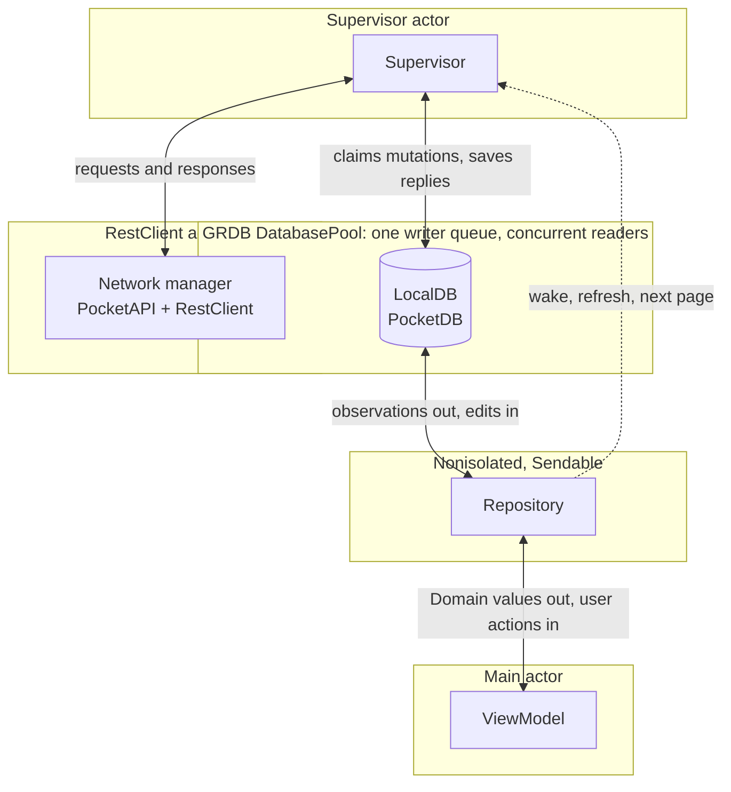

# iOS architecture

The app target is thin. All code lives in local Swift packages under `Layers/`, grouped in three layers. A package may depend only on packages in a lower layer, never on one beside it or above it.

```
PocketDemo/                 app target: AppDelegate, PocketDemoApp, assets
Layers/
  Foundation/               no dependency on other packages
    Domain/                 Codable server model and the values views display: rows, detail, conflicts, sync status
    PocketNetworking/       generic REST client: endpoints, adapters, connectivity, cancellation
    PocketUI/               shared SwiftUI components and colors; knows nothing about recordings data or storage
  Services/
    PocketSync/             SQLite database, GRDB records, server API calls and the Supervisor
  Features/
    PocketRecordings/       Repository, ViewModels and the list, detail, edit and conflict screens
```

| Package | Depends on |
| --- | --- |
| `Domain`, `PocketNetworking`, `PocketUI` | nothing local |
| `PocketSync` | `Domain`, `PocketNetworking`, GRDB, swift-dependencies |
| `PocketRecordings` | `Domain`, `PocketUI`, `PocketSync`, swift-dependencies |

Inside a package, a folder holds one kind of code: `Database/`, `Remote/`, `Supervisor/` and `Dependencies/` in PocketSync, and `Models/`, `Repository/`, `ViewModels/` and `Views/` in PocketRecordings. Packagebot generates every `Package.swift` with `make layers`, and XcodeGen generates the Xcode project with `make project`.

`AppDelegate` opens and migrates the database off the main actor, configures the client with the saved device ID, registers dependencies and starts the Supervisor. `PocketDemoApp` shows a progress view until that finishes, then the recordings list, and forwards foreground events.

## Data flow and isolation



Data reaches the screen only through the database. The Supervisor writes server replies to LocalDB, GRDB's `ValueObservation` reports the committed change to the Repository, and the Repository hands Domain values to the ViewModel. User edits go the other way: the Repository writes a mutation row and the Supervisor sends it later. The dashed arrow is the Repository asking the Supervisor to start work. It carries no data.

Each box runs in its own isolation domain:

| Part | Isolation | What it may touch |
| --- | --- | --- |
| ViewModel | `@MainActor @Observable` | The Repository only |
| Repository | Nonisolated `Sendable` struct | LocalDB, and the Supervisor's wake calls |
| LocalDB | GRDB's queues; reads and writes are `async` | Nothing above it |
| Supervisor | `actor` | LocalDB and the network manager |
| Network manager | `RestClient` is an `actor` | The server |

The ViewModel never sees a record or a request, and the Supervisor holds no reference to a ViewModel or view.

## Database models

Each record declares its properties, `CodingKeys` and typed `Columns`. Extensions contain query methods, editing operations, sync operations and `createTable`. Split records keep their main declaration and extensions together in a folder named after the record, such as `Records/SyncStateRecord/`. `make check-swift-file-groups` enforces this layout. `MigratableTable` and the ordered table list register migrations. There is no upgrade from databases created before browse paging; those installs start fresh. The wrapper has no preview factory or fallback to an empty database.

The `recordings` table stores the latest server copy. It has one title and one summary. The `mutations` table stores local edits and deletes awaiting synchronization. The feature observes typed GRDB queries with `ValueObservation`. When constructing a Domain value, the record conversion applies pending field values. This preserves local edits during refresh without duplicate title columns or an `Overlay` service.

An edit inserts a mutation and updates recording status in one transaction. The Supervisor claims rows in FIFO order, sends the exact saved request, and removes acknowledged rows. Uncertain responses leave the request unchanged for replay. Conflicts stay available for user resolution. A pending delete never hides an unresolved conflict.

`Recording` is the canonical Codable server model. `RecordingRecord` is its GRDB representation. `RecordingRow` and `RecordingDetail` contain the values the views display. Endpoint response envelopes describe list, write and detail JSON structure; there is no separate recording DTO or ServerRecording copy.

The editor keeps the server revision from when it opened and submits only fields the user changed. A refresh cannot silently replace that revision or cause an untouched field to be submitted.

## Observation and synchronization

The Repository exposes GRDB's throwing observation sequences. ViewModels consume them from view tasks and report read failures. The Supervisor updates database records and has no reference to a ViewModel or view.

One Supervisor loop handles changes, refresh, reconnect, transcript requests and the next list page. It restores the saved airplane switch before requests begin. A first launch loads one browse page of 30 and takes the change-feed cursor from it, so later refreshes download only changes. Scrolling near the end loads the next 30. A server reset drops cached rows, browses the first page again, refreshes recordings with local work by ID (accepting lower versions), rebases their mutations and only then sends them; an interrupted reset resumes after relaunch. Cached transcripts share an experimental 30 MB limit, evicting the least recently opened first.
